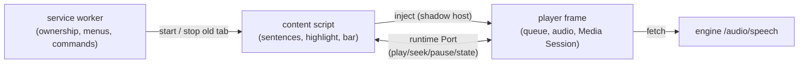
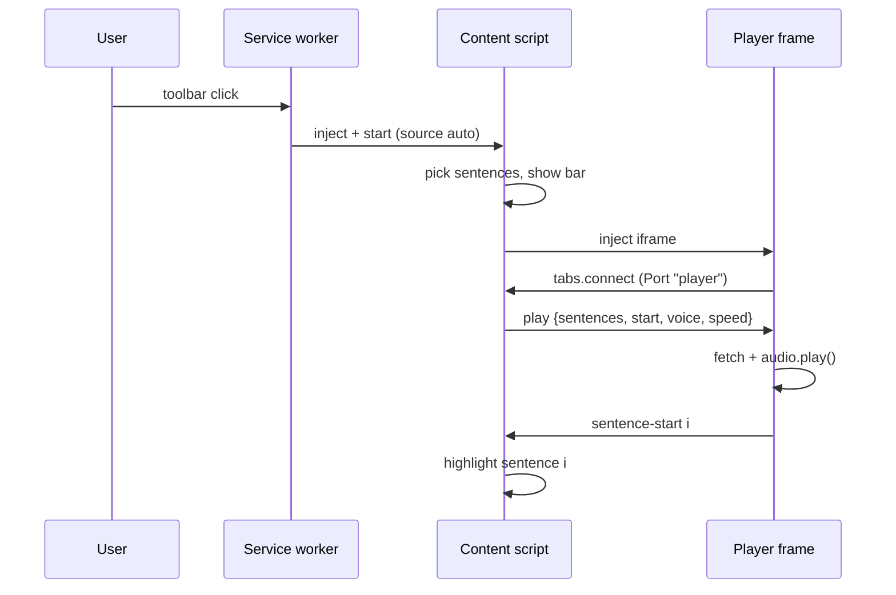

# Design: mobile reader

## Glossary

- **Player frame** — an extension-origin iframe the content script injects into the reading tab; it owns the sentence queue and the `<audio>` element and plays on every platform. _Avoid_: offscreen document, offscreen player.
- **Media Session controls** — play/pause/next/previous exposed through the Media Session API, reachable from the lock screen, notification shade, headset and hardware media keys. _Avoid_: media notification, lock-screen buttons.
- **Selection actions** — the "▶ From here" and "▶ Selection" buttons the player bar shows while text is selected during a session, replacing the context menu and Alt+click on touch. _Avoid_: selection chip, floating button.

## Decisions

- Target: one mobile-ready Chromium build. Developed and tested on Vivaldi Android (sideload); users install it from the Chrome Web Store in Vivaldi (and Brave once it ships extensions); an Edge Android allowlist request runs in parallel.
- Audio moves from the offscreen document to the player frame on all platforms; the `offscreen` permission is dropped. Evidence: spike `spikes/lektor-lockscreen-audio` 0.0.1/0.0.2 on Vivaldi Android (S23 Ultra), 2026-11-16 — the iframe autostarts from the toolbar click with no tap inside it, and keeps fetching and playing sentences with the screen locked; the offscreen document stops when the screen locks.
- Touch start points: selection actions live in the player bar (bottom, thumb reach) rather than next to the selection, because Android's native selection menu already occupies that spot and extensions cannot add entries to it. Desktop keeps the context menu and Alt+click.
- Bar layout: mockup option A (one transport row, selection strip above, ⋯ fold-out). Option B hid prev/next behind an extra tap, and option C blocked pausing while text is selected.
- The Edge Android allowlist request is part of this change: the listing kit gains a mobile section, and Greg submits the Microsoft form.

## Architecture

- **Player frame.** `src/player.html` + `src/player.mjs` is listed in `web_accessible_resources` for `<all_urls>`. The content script appends it inside its shadow host as a 1×1, visually hidden iframe with `allow="autoplay"`. `src/offscreen/queue.mjs` and `src/offscreen/player.mjs` move to `src/player/` unchanged apart from imports. The frame reads engine settings from `chrome.storage` itself, because an extension page has that API, unlike the offscreen document.
- **Messaging.** On load, the frame calls `chrome.tabs.getCurrent()` and opens `chrome.tabs.connect(tabId, { name: "player" })` to the content script of its own tab. Commands (`play`, `seek`, `pause`, `resume`, `stop`, `set-speed`, `set-voice`) and events (`sentence-start`, `state`, `error`) keep their current shapes and flow over this Port. The page cannot read or forge Port messages, which it could with `window.postMessage`.
- **Service worker.** It keeps single-session ownership (starting in tab B tells tab A to stop), the context menus, the `toggle-reading` command and options opening. It no longer relays audio commands. `ensureOffscreen`, `offscreenAlive`, `replay`, `stopOffscreen` and `REPLAYABLE` are removed. The frame dies with the tab, so reload, navigation and close end the audio with no extra code.
- **Media Session controls.** On each `sentence-start`, the frame sets `MediaMetadata` { title: page title, artist: "Lektor TTS", album: voice } plus the action handlers play, pause, nexttrack (next sentence) and previoustrack (previous sentence). Every handler reports a `state` event back, so the bar stays in sync.

### Sequence: start from the toolbar

## Interactions

- **Toolbar start.** Unchanged: with no selection it reads the article, with a selection it reads the selection. Whether a selection survives a tap on the Vivaldi toolbar is checked on the device. If it does not, the selection actions cover that case.
- **Selection actions.** The content script listens to `selectionchange`, debounced by 150ms. While a session exists and the selection is non-collapsed and outside the bar, the bar shows the strip. "▶ From here" starts a `from-here` session at the selection's start node, using the same pane narrowing as Alt+click. "▶ Selection" starts a `selection` session. Either one collapses the selection, which hides the strip.
- **Desktop.** The context menu, `Alt+Shift+R` and Alt+click stay. The selection actions also appear on desktop.
- **Speed chip.** It cycles 0.8 → 1.0 → 1.2 → 1.5 → 2.0 → 0.8. From any value not in that list, such as 1.3 set with the slider, it moves to the next larger preset, and from above 2.0 it goes to 0.8. The value is saved as the default speed, like the slider.

## Error handling

- **Frame lost.** If the Port disconnects while a session is live (for example, the page removed the iframe), the content script re-injects the frame once and replays from the current sentence. A second failure shows the existing bar error with Retry.
- **Engine errors** (HTTP error, network, timeout) arrive as `error` events over the Port and render as today: the message, an "Open options" link and Retry.
- **Autoplay refused.** If `audio.play()` rejects with `NotAllowedError`, the frame emits `state: paused`. The bar shows ▶, and one tap resumes, which counts as a gesture.

## Testing

- **Unit (vitest + jsdom):** the frame module with an injected port and `audio` (the moved offscreen tests); Media Session handlers against a fake `navigator.mediaSession`; the selection strip on `selectionchange`; the speed chip cycle; Port disconnect → re-inject once → error.
- **Manifest test:** no `offscreen` permission; `src/player.html` is web-accessible; `host_permissions` unchanged.
- **Visual verification:** `pnpm screenshots` captures the bar in three states at 390px and 1280px against the fake engine.
- **Device checklist (Vivaldi Android):** the same list becomes the Edge Android QA test cases in `store/listing.md`.
- **Risk checked first:** the spike used a *visible* iframe and did not confirm the Media Session notification from a frame. Task 1 re-runs the spike with a 1×1 hidden frame and checks the lock-screen controls. If a hidden frame fails, the frame stays 1px visible inside the bar.

## Mockups

### [projects/omnivoice-server/mockups/2026-11-16-lektor-mobile-bar-options.html](/project/omnivoice-server/mockups?file=omnivoice-server%2Fmockups%2F2026-11-16-lektor-mobile-bar-options.html)
- Surface: player bar (content script shadow DOM), option A; viewport(s): 390px, 1280px
- Check:
  - Playing: one row in order prev · play/pause · next · speed chip · spacer · ⋯ · close; nothing wraps at 390px
  - Every control is at least 44×44px; play/pause uses the accent fill
  - Speed chip cycles 0.8 → 1.0 → 1.2 → 1.5 → 2.0 → 0.8 and always shows the current speed, including a slider value such as 1.3×
  - Text selected during a session: a strip with two equal-width buttons "▶ From here" and "▶ Selection" appears above the row; the transport row does not move horizontally; the strip disappears when the selection collapses
  - ⋯ open: a fold-out under the row with Voice select, Speed slider with value, and Autoscroll toggle; ⋯ becomes a collapse control
  - The bar floats above the browser's bottom toolbar, rounded corners, `#1f2328` background, 10px side margins
  - Desktop (1280px) uses the same layout and does not stretch to full width
- Agreed deviations:
  - none

Visual verification: yes
